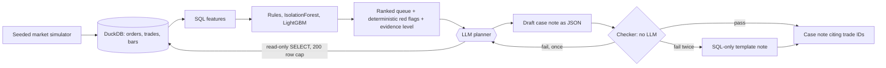

# ComplyLite

A ranked alert queue and a checked case note for a small broker's compliance analyst.

**All data in this repository is simulated.** There are no real clients, orders or trades. The numbers below show that
the pipeline finds the manipulation patterns the simulator plants. They do not show how it would do on a real order book.

## Who it is for

A compliance analyst at a small stockbroker who gets far more surveillance alerts each day than they can review. The
analyst wants two things:

1. A short queue, ranked so the alerts most likely to be real come first, with the reasons shown.
2. For each alert, a draft case note that cites the trade IDs it is about, so the analyst can check it in minutes
   instead of writing it from scratch.

## One measured result

On 10 simulated holdout trading days (4,325 client-symbol-day units, 255 true alerts, 24,648 trades), reviewing
50 alerts a day, with every method given the same workload:

| Method | PR-AUC | Precision@50 per day | False alarms per 10k trades |
|---|---|---|---|
| Rules only (fixed) | 0.38 | 0.21 | 161 |
| IsolationForest | 0.26 | 0.35 | 132 |
| LightGBM | 0.97 | 0.50 | 101 |
| Rules + LightGBM | 0.97 | 0.50 | 101 |
| Best possible queue | 1.00 | 0.51 | 99 |

LightGBM raises 101 false alarms per 10,000 trades where the fixed rules raise 161, and it catches all four planted
patterns where the rules catch one. The best possible queue is 0.51 precise because the holdout averages about 26 true
alerts a day, fewer than the 50 slots.

Read the limits before the headline. The features were written with these four patterns in mind, and when one pattern is
left out of training the model's recall for it in the daily queue falls to 0.69 (wash trade), 0.08 (spoofing),
0.04 (pump and dump) and 0.00 (front running). A harder simulator preset gives LightGBM PR-AUC 0.95. Full tables, setup
and caveats: [reports/EVAL.md](reports/EVAL.md), [reports/EVAL_HARD.md](reports/EVAL_HARD.md) and
[reports/EDA.md](reports/EDA.md). All three, and `reports/metrics.json`, are written by scripts in `scripts/`.

## Where the language model is and is not allowed



The model sits in one place. It may choose which read-only queries to run and write the prose of a draft note. It may not:

- rank alerts or score anything (the queue comes from the models above, before the LLM is involved);
- decide how strong the evidence is or how strong the conclusion may be (computed in code from the red flags and the model score);
- write to the database or read files (the DuckDB connection is read-only with external access off, and a SELECT-only guard sits in front of it);
- have the last word on facts: the checker recomputes every figure from the cited trades in SQL, requires every cited trade ID to exist and belong to the alert, traces every number in the text to a tool result, and rejects words like "proves" or "intentional".

If the second draft also fails the checker, or the API is down or out of quota, the note is built from SQL alone, with no model.

### Agent status

The agent and checker are covered by offline tests (the model is stubbed). Against the live Groq model, a single alert
was drafted and passed the checker on the first try during development, but the 20-alert measurement is **not done**:
the free-tier key's 200,000 tokens-per-day quota ran out before it could finish. In that attempt all 20 alerts fell
back to the template note and all 20 template notes passed the checker
([reports/agent_eval_quota_blocked.json](reports/agent_eval_quota_blocked.json)). That says the fallback works. It says
nothing about the model's pass rate. To measure it, run `python scripts/run_agent_eval.py` with a key that has quota; it
writes the first-try and after-retry checker pass rates and latency to `reports/AGENT_EVAL.md`.

## Quick start

Python 3.11. Nothing here needs a GPU or network except the optional model call.

```bash
python -m venv .venv && source .venv/bin/activate        # Windows: .venv\Scripts\activate
pip install -r backend/requirements.txt

python scripts/simulate.py                # seeded data in data/sim/default (git-ignored)
python scripts/run_eval.py                # reports/EVAL.md, reports/metrics.json, charts, and the ranked queue
python scripts/run_eda.py                 # reports/EDA.md

cd backend && PYTHONPATH=. python -m pytest app/tests -q        # offline, no API key needed
cd backend && uvicorn app.main:app --port 8000
```

Then:

```bash
curl "localhost:8000/api/v1/surveillance/queue?limit=5"                         # ranked alerts, latest holdout day
curl "localhost:8000/api/v1/surveillance/alerts/20260413-C00546-SC06/note"      # checked case note
```

The note endpoint uses Groq's OpenAI-compatible API (`openai/gpt-oss-120b`) when `GROQ_API_KEY` is set in the environment
or in a git-ignored `.env` at the repo root, and the SQL-only template otherwise. The response says which one produced
the note (`source`) and what the checker found.

To measure the agent: `python scripts/run_agent_eval.py` (Groq, 20 alerts, paced for rate limits) or
`--llm stub-mistakes` for an offline run that exercises the retry path.

## Layout

| Path | What is there |
|---|---|
| `backend/app/surveillance/simulator.py` | Seeded, labeled market simulator with four planted patterns and hard negatives |
| `backend/app/surveillance/sql/` | DuckDB feature and rule SQL, one file per feature family |
| `backend/app/surveillance/pipeline.py` | Time-based split, model comparison, writes the ranked queue |
| `backend/app/surveillance/agent/` | Read-only tools, SQL guard, checker, case-note flow, model clients |
| `backend/app/api/surveillance.py` | Queue and case-note endpoints |
| `scripts/` | `simulate.py`, `run_eval.py`, `run_eda.py`, `run_agent_eval.py` |
| `reports/` | Generated evaluation, EDA and figures |
| `.github/workflows/ci.yml` | Tests, lint of the surveillance code, and a tiny-dataset eval smoke test |

The repository also contains the earlier upload-and-rules dashboard (`frontend/`, the `/api/v1/alerts` and
`/api/v1/data` routes). It is separate from the surveillance pipeline above.
