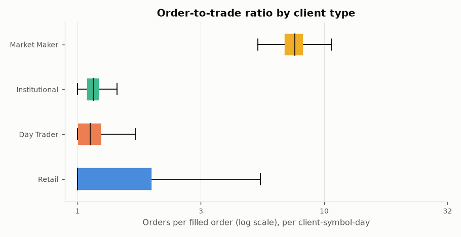
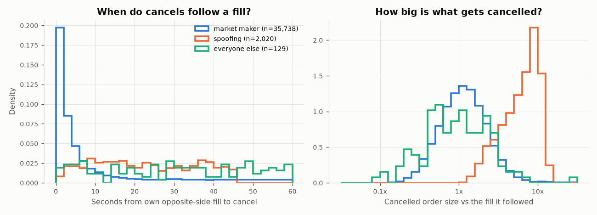
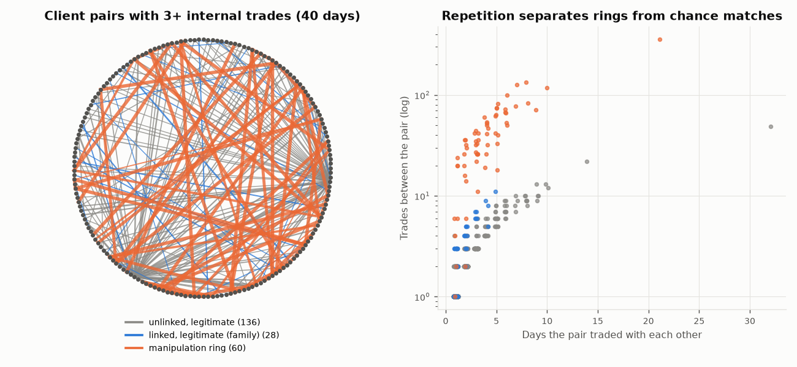
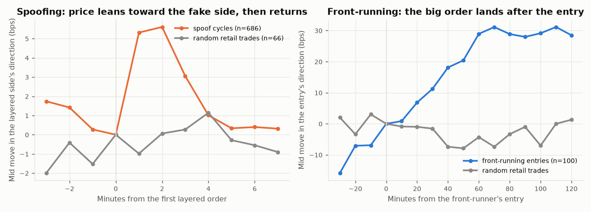

# Exploratory analysis of the simulated order book

Generated by `scripts/run_eda.py` from `data/sim/default` (seed 42). **All data is simulated.** Labels are
used here only to colour the charts. The point is to check that the simulator behaves the way the
detectors assume, and to see which signals overlap with legitimate trading.

## 1. Order-to-trade ratios

Market makers send a median of 7.6 orders per fill and cancel 87% of their orders. Retail clients sit at 1.0 orders per fill (33% cancelled), intraday traders at 1.1. A high cancel rate on its own mostly finds market makers,
which is why it is a poor alert by itself and why the unsupervised IsolationForest score keeps
surfacing them.

## 2. Cancel clustering

Market makers and spoofers both cancel resting orders shortly after a fill on the other side. Market
makers pull the rest of a ladder fast (median 3.1 s); spoofers take longer (median 22.2 s), but both land inside the same short window, and market makers produce 35,738 such cancels against 2,020 for spoofers. A timing rule alone would bury the spoofers. Size separates them more cleanly: what a spoofer cancels is a median 6.8x the fill it followed, against 1.1x for a market maker.
That is why `cancel_fill_size_ratio` and the placed-versus-filled imbalance matter more than the raw
cancel count.

## 3. Client-pair network

Internal matches between clients happen by chance all the time: 1,752 unlinked legitimate pairs traded with each other at least once, a median of 1 trade on 1 day. Manipulation-ring pairs (63) trade with each other a median of 36 times over 3 days. The 41 family pairs that traded with each other did so a median of 3 times on 1 day, usually moving holdings between relatives. So
being linked is weak evidence on its own; repeated trading between the same two accounts over several
days is much stronger.

## 4. Price impact around injected windows

One minute after a spoofer starts layering, the mid has moved 5.3 bps toward the fake side on average (random retail trades: -1.0 bps), then drifts back once the orders are pulled. An hour after a front-runner's entry the price has moved 29 bps in its favour (baseline -4.3 bps), because the institution's order lands in between. These moves are small next to normal volatility, which is why the price-impact features help but cannot carry a case alone.

## What this means for the detectors

- No single signal is clean. Cancels point at market makers, internal matches happen by chance, and
  linked accounts are usually families. The signal is in combinations: size plus timing for spoofing,
  repetition plus near-zero price change for wash trades, timing against dealer flow for front-running.
- These are properties of the simulator. They match how the patterns are usually described, but real
  data will be noisier and the overlaps larger.
