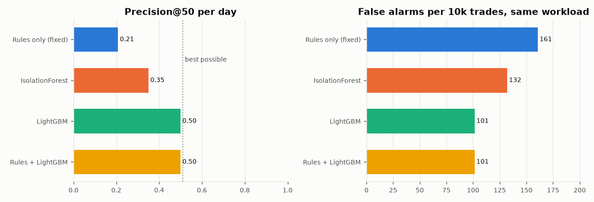
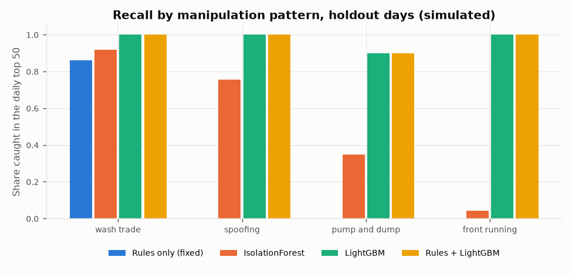
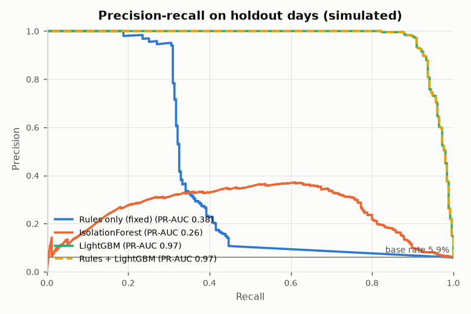
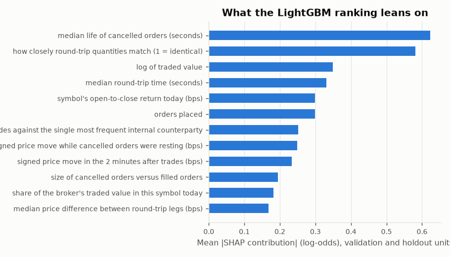

# Evaluation: ranking surveillance alerts on simulated trading data

Generated by `scripts/run_eval.py`. Every number below comes from that script run on data from
`scripts/simulate.py`. **The data is simulated.** It shows the pipeline finds the patterns we planted
and how the methods compare on the same queue. It does not show how any of this would do on a real
broker's order book.

## Setup

- Dataset: seed 42, 40 trading days, 742 clients, 30 symbols,
  270,752 orders, 97,781 trades. Config is in `data/sim/default/config.json`.
- Injected events: 277 wash trade, 234 spoofing, 11 pump and dump, 100 front running.
- Unit of review: one client trading one symbol on one day. A unit is a true alert if an injected
  manipulation touched it. Hard negatives (market makers, intraday scalpers, family accounts, news
  buyers, pump bystanders, dealer followers) are labeled 0 like everything else.
- Split by trading day, never at random: train 24 days, validation 6 days, holdout 10 days (2026-04-13 to 2026-04-24).
- Early stopping (best iteration 297) and the rules+model blend weight (0.0) were picked on validation days. The holdout was scored once.
- The analyst reviews about 50 alerts a day, so the queue metrics take the top 50 units per day.

## Holdout results (10 days, 4,325 units, 255 true alerts, 24,648 trades)

| Method | PR-AUC | Precision@50 per day | False alarms per 10k trades (same workload) | Recall: wash trade | Recall: spoofing | Recall: pump and dump | Recall: front running |
|---|---|---|---|---|---|---|---|
| Rules only (fixed) | 0.38 | 0.21 | 161 | 0.86 | 0.00 | 0.00 | 0.00 |
| IsolationForest | 0.26 | 0.35 | 132 | 0.92 | 0.75 | 0.35 | 0.04 |
| LightGBM | 0.97 | 0.50 | 101 | 1.00 | 1.00 | 0.90 | 1.00 |
| Rules + LightGBM | 0.97 | 0.50 | 101 | 1.00 | 1.00 | 0.90 | 1.00 |
| Best possible queue | 1.00 | 0.51 | 99 | 1.00 | 1.00 | 1.00 | 1.00 |

How to read it. PR-AUC ranks every unit on the holdout days. Precision@50 and the recall columns use
a full queue: the top 50 units each day (for the rules, only units where a rule fired). False alarms
are counted at the same workload for everyone: each day every method raises as many alerts as the
rules did that day, capped at 50 (on average 50 a day here), so a method
cannot look better just by raising fewer alerts.

Precision@50 cannot reach 1.0 here: the holdout averages 26 true alerts a day, so a perfect queue of 50 is at most 0.51 precise. Recall is the share of each pattern's units that made the daily queue.

### What the rules do today

Without a cap, the fixed rule pack raises 107 alerts a day on the holdout, against a review capacity of 50. 11% of them are true, and it raises 388 false alarms per 10,000 trades. Its recall is 0.93 for wash trade, 0.02 for spoofing, 0.00 for pump and dump, 0.00 for front running. The rules have nothing that looks at cancels, dealer flow or multi-day price context, so they barely see spoofing, front-running or pump-and-dump.
Most of its false alarms come from intraday round trip (67%), ordinary activity (17%), market maker (10%).

### What changes with the model

- For the same number of alerts a day, the rules make 161 false alarms per 10,000 trades, LightGBM 101 and rules + LightGBM 101. The floor is 99: with about 26 true alerts a day, some slots must hold false ones.
- In the full top-50 queue, LightGBM's precision@50 is 0.50 against 0.21 for the rules, and it catches all four patterns instead of one.
- IsolationForest, which never sees labels, reaches PR-AUC 0.26. Its false alarms are mostly legitimate but unusual clients: market maker (37%), ordinary activity (26%), family same symbol (22%).
- The blend weight picked on validation was 0.0: on this data the rule score adds nothing the model does not already know, so rules + LightGBM ranks almost like LightGBM alone.

### A pattern the model was never shown

The supervised scores above are close to perfect because the features were written with the four
planted patterns in mind and the model trained on labeled examples of each. To see what happens with
a new kind of manipulation, the script retrains LightGBM four times, each time removing one pattern from
the training and validation days, and checks how much of that pattern still reaches the holdout queue.

| Pattern left out of training | Recall in the daily queue | PR-AUC for that pattern |
|---|---|---|
| wash trade | 0.69 | 0.30 |
| spoofing | 0.08 | 0.02 |
| pump and dump | 0.04 | 0.01 |
| front running | 0.00 | 0.01 |

This is the number to take seriously. A supervised ranker learns the manipulation it has seen; the
rules and the unsupervised score are the backstop for what it has not.

### Harder variant

`--preset hard` keeps the same market but makes the manipulation subtler: at most 4 wash round
trips, fewer fixed-price legs, smaller and fewer spoof layers, most front-runners using their own
online login instead of the dealer's terminal, smaller pumps with fewer circular trades. Full
write-up in [EVAL_HARD.md](EVAL_HARD.md).

| Method | PR-AUC | Precision@50 per day | False alarms per 10k trades (same workload) | Recall: wash trade | Recall: spoofing | Recall: pump and dump | Recall: front running |
|---|---|---|---|---|---|---|---|
| Rules only (fixed) | 0.24 | 0.14 | 183 | 0.57 | 0.00 | 0.00 | 0.00 |
| IsolationForest | 0.21 | 0.29 | 150 | 0.86 | 0.66 | 0.06 | 0.00 |
| LightGBM | 0.95 | 0.49 | 109 | 1.00 | 0.97 | 0.81 | 1.00 |
| Rules + LightGBM | 0.95 | 0.49 | 109 | 1.00 | 0.97 | 0.81 | 1.00 |

## Validation days (used for early stopping and the blend weight)

| Method | PR-AUC | Precision@50 per day | False alarms per 10k trades (same workload) |
|---|---|---|---|
| Rules only (fixed) | 0.37 | 0.20 | 167 |
| IsolationForest | 0.27 | 0.37 | 132 |
| LightGBM | 0.99 | 0.52 | 101 |
| Rules + LightGBM | 0.99 | 0.52 | 101 |

## Per-alert explanations

Each queued alert carries its top LightGBM SHAP contributions (`pred_contrib=True`, no extra
dependency) plus the deterministic red flags in `app/surveillance/evidence.py`. Overall, the model
leans most on:

## Honest limits

- The simulator and the features were written by the same person, so the features fit the planted
  patterns well. Real manipulation is rarer, messier and changes when people know what is watched.
- The simulator's difficulty knobs (event strength, hard-negative mix) were adjusted while looking at
  validation results, because the first version was trivially separable. Holdout days were not used.
- A broker only sees its own clients. Counterparties at other brokers show up as `EXT`, which the
  simulator models, but real exchange data has more structure than that.
- One seed, one split. Run `python scripts/simulate.py --seed N` and re-run this script to see the spread.

Runtime: features and rules 1.6 s, training 0.7 s, whole script 7.1 s on a laptop CPU.
